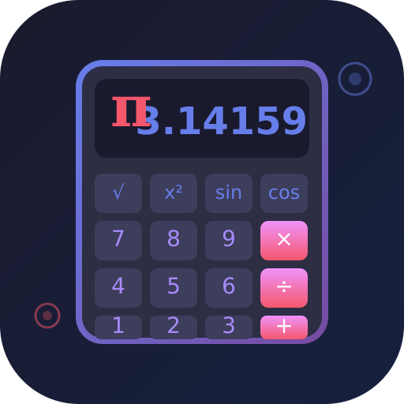

<p align="center">
  
</p>

<h1 align="center">🔬 Scientific Calculator</h1>

<p align="center">
  Powerful, elegant, and bilingual scientific calculator for Android — dual mode (Basic & Scientific), Material Design 3, 100% offline.
</p>

<p align="center">
  <a href="https://github.com/lunarcadedigital/scientific-calculator/releases">
    
  </a>
</p>

<p align="center">
  
  
  
  
</p>

---

## ⚠️ Disclaimer

> Aplikasi ini dibuat untuk tujuan **edukasi dan produktivitas**. 100% offline, tanpa tracking, tanpa iklan.

## ✨ Features

| Feature | Description |
|---------|-------------|
| 🔢 Dual Mode | Basic & Scientific calculator in one app |
| 🔬 Scientific Functions | Trigonometry, logarithms, powers, factorial, constants (π, e) |
| 🌍 Bilingual | English & Bahasa Indonesia |
| 🎨 Material Design 3 | Modern UI with Light/Dark/System themes |
| 📋 Copy Results | One-tap copy to clipboard |
| 🔒 100% Offline | No internet required, no tracking, no ads |
| ✅ Fully Tested | 82 unit tests passed |

## 📱 Screenshots

<p align="center">
  <em>Coming soon...</em>
</p>

## 🚀 Installation

### Prerequisites
- Android 7.0+ (API 24+)
- Android Studio or Gradle

### Build from Source
```bash
# Clone this repository
$ git clone https://github.com/lunarcadedigital/scientific-calculator

# Go into the repository
$ cd scientific-calculator

# Build debug APK
$ ./gradlew assembleDebug

# Install to connected device
$ ./gradlew installDebug
```

> **Note:** Requires Android SDK 34 and Java 17+.

### Download APK
Download the latest release from [Releases](https://github.com/lunarcadedigital/scientific-calculator/releases).

## 🎮 Usage

| Mode | Description |
|------|-------------|
| 🔢 Basic | Addition, subtraction, multiplication, division, percentages |
| 🔬 Scientific | sin, cos, tan, log, ln, x², xⁿ, √x, n!, π, e |

## 🛠️ Tech Stack

| Technology | Purpose |
|------------|---------|
| Kotlin | Primary language |
| Jetpack Compose | UI framework |
| Material Design 3 | Design system |
| DataStore | Preferences storage |
| JUnit | Unit testing |

## 📋 Changelog

### v1.0.0
- Initial release
- Basic & Scientific modes
- Dark/Light/System theme
- English & Bahasa Indonesia
- 82 unit tests

See [CHANGELOG.md](CHANGELOG.md) for version history.

## 👥 Contributors

| Name | Division | Role |
|------|----------|------|
| Agus Pratama | Architect | System architecture |
| Siti Rahayu | Release | Release engineering |
| Dimas Pratama | Fixing | Bug fixes & patching |
| Dimas Erlangga | Design | UI/UX design |
| Ahmad Fauzi | Android | Business logic & data layer |
| Budi Santoso | Asset | 2D assets & visuals |
| Rizal Fadillah | Qa | Quality assurance & testing |
| Fajar Nugroho | Android | Business logic & data layer |
| Dewi Lestari | Archive | Documentation & archival |
| Nina Salsabila | Research | Tech research & analysis |

## 📄 License

MIT License

Copyright (c) 2026 Lunarcade Digital

---

<p align="center">
  <sub>© 2026 Lunarcade Digital. All rights reserved.</sub>
</p>
